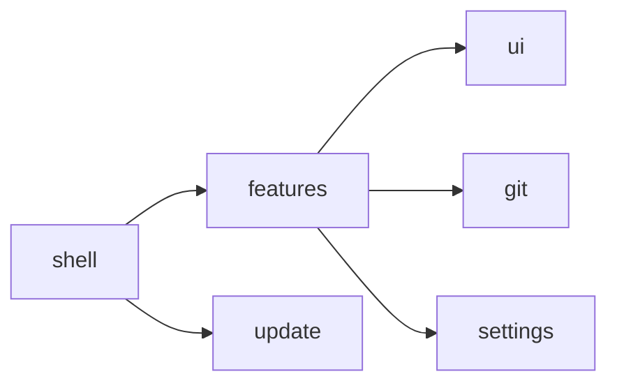

# Contributing to Rama

Thanks for taking the time to contribute! This guide covers how to report
problems, propose changes, and get a pull request merged.

By participating you agree to follow the [Code of Conduct](CODE_OF_CONDUCT.md).

## Ways to contribute

- **Report a bug** — [open a bug report](https://github.com/yosoyjaff/rama/issues/new?template=bug_report.yml)
  with the steps to reproduce it, what you expected, and your OS and Rama version
  (*Settings → About*).
- **Suggest a feature** — [open a feature request](https://github.com/yosoyjaff/rama/issues/new?template=feature_request.yml)
  describing the problem it solves, not only the solution.
- **Improve the docs**, the copy in the app, or the design.
- **Write code** — pick an open issue, or open one first for anything larger
  than a small fix so we can agree on the approach before you spend time on it.

Security problems are the exception: report them privately as described in
[SECURITY.md](SECURITY.md).

## Development setup

1. Install a stable [Rust toolchain](https://rustup.rs). On Linux, also install
   the system libraries listed in the [README](README.md#build-from-source).
2. Clone and run:

   ```bash
   git clone https://github.com/yosoyjaff/rama.git
   cd rama
   cargo run
   ```

   The first build compiles GPUI and takes a few minutes. Dependencies are
   optimised even in debug builds, so `cargo run` is usable day to day.

## Before you open a pull request

Run the same checks a reviewer will:

```bash
cargo fmt
cargo clippy --all-targets   # --all-targets also compiles the tests
cargo test
```

- `cargo check` does **not** compile `#[cfg(test)]` code — always use
  `clippy --all-targets`.
- For anything visual, run the app and try the change. Screenshots or a short
  recording in the PR description help reviewers a lot.
- Add or update tests for behaviour you change. Logic that doesn't need a
  window (parsing, Git output, layout maths) should be unit-tested; views can be
  tested with GPUI's headless test harness (`#[gpui_kit::test]`).

## Project structure

Rama is a single crate. The boundaries are modules, and dependencies flow one
way:



| Path | What lives there |
| --- | --- |
| `src/main.rs` | Startup: settings, theme, menus, the window. |
| `src/shell.rs` | The root view: the title bar and what is mounted below it. The only place that decides what goes where. |
| `src/features/` | The product: the workspace and its tabs, home screen, history graph, diff viewer, settings. A feature never depends on another feature or on the shell. |
| `src/ui/` | Reusable chrome that knows nothing about Git: theme, title bar, inputs, popovers, toasts, icons. |
| `src/git/` | The Git layer: reading history and running operations through the `git` CLI. No UI. |
| `src/update/`, `src/updater.rs` | Release manifest, update check and install; the shell's wiring of it. |
| `src/actions.rs`, `src/keymap.rs` | Application-wide actions and their key bindings. |
| `assets/` | Icons and the app icon. `packaging/` holds the release scripts. |

More background is in [`docs/ARCHITECTURE.md`](docs/ARCHITECTURE.md) and
[`docs/PACKAGING.md`](docs/PACKAGING.md).

## Conventions

- **One command, one implementation.** A command is a GPUI `Action` in
  `src/actions.rs`. Its key binding, menu item and button all dispatch the same
  action (`window.dispatch_action(...)`), and one view handles it.
- **No invisible behaviour.** Every action ships with a way to reach it from
  the UI in the same change.
- **Use theme tokens, not colour literals.** Read colours from the theme and
  derive tints from them (`theme.text.opacity(0.1)`).
- **Stable, domain-based element IDs** — never a list index; rows reorder.
- **Never mutate state or call `cx.notify()` inside `render`.**
- **Prefer GPUI Kit components** over rebuilding a control from `div`s, so focus,
  keyboard, disabled state and accessibility come for free.
- Keep blocking work (Git, network, disk) off the main thread: run it on the
  background executor and update the view when it finishes.

The GPUI Kit coding and design guides are bundled in
`.claude/skills/build-gpui-apps/` and are the reference for UI work.

## Commits and pull requests

- Keep each pull request focused on one change; split unrelated work.
- Write commit messages in the imperative mood with a short summary line
  (`Add blame view`, `Fix crash when the repo has no commits`), and explain the
  *why* in the body when it isn't obvious.
- Link the issue the PR addresses (`Fixes #123`).
- Make sure the checks above pass and the PR template is filled in.

## Releases

Maintainers publish a release by bumping `version` in `Cargo.toml`, moving the
`[Unreleased]` entries of `CHANGELOG.md` under a `## [x.y.z] - YYYY-MM-DD`
heading (the workflow refuses a version without one; it becomes the release
notes), and pushing a matching tag:

```bash
git tag v0.2.0 && git push origin v0.2.0
```

The release workflow builds every platform, attaches the archives and the
update manifest, and the app offers the new version to existing installs. See
[`docs/PACKAGING.md`](docs/PACKAGING.md) for details.

## License

By contributing, you agree that your contributions will be licensed under the
project's [MIT License](LICENSE).
