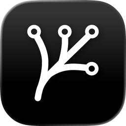
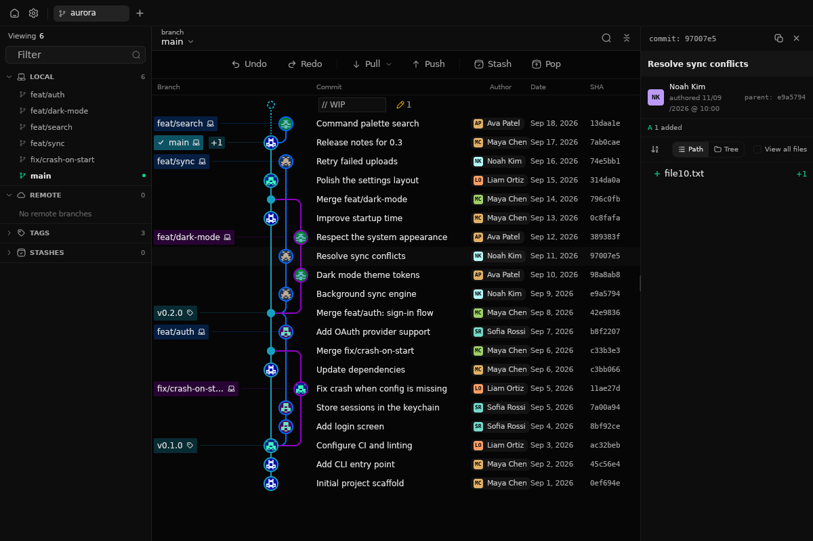

<div align="center">



# Rama

**A fast, native Git client for Windows, macOS and Linux.**

Built in Rust on [GPUI](https://www.gpui.rs), the GPU-accelerated UI framework behind the Zed editor.

[](LICENSE)
[](https://github.com/yosoyjaff/rama/releases)
[](#install)
[](https://www.rust-lang.org)
[](CONTRIBUTING.md)

[Install](#install) · [Features](#features) · [Build from source](#build-from-source) · [Roadmap](#roadmap) · [Contributing](#contributing) · [Support the project](#support-the-project)



</div>

---

Rama puts your repository's history front and centre: a clear commit graph,
every branch and tag in reach, and the everyday Git operations one click away —
without the weight of a web runtime. It starts quickly, stays responsive on
large histories, and looks at home on every desktop.

> [!NOTE]
> Rama is in **early development**. It is already usable day to day, but
> expect rough edges and changes between releases. Feedback and bug reports
> are very welcome.

## Features

**History**
- Commit graph with lanes, merges, branch and tag badges, stashes and a work-in-progress row
- Collapse branches or switch to a branch-tips overview
- Search that highlights matches in place, with next/previous navigation
- Sidebar with local and remote branches, tags and stashes
- Author, date and SHA columns you can show, hide, resize and reorder

**Changes**
- Commit details with the files changed, as a list or a tree
- Diffs side by side or inline, with syntax highlighting
- Blame, and a merge editor for resolving conflicts
- Stage and commit from the working-tree row

**Git operations**
- Pull (fast-forward, fast-forward only, or rebase), push, fetch all
- Stash and pop, undo and redo the last commit
- Create, rename, check out and delete branches; set upstreams
- Merge, rebase, interactive rebase, cherry-pick, revert and reset
- Tags, patches and worktrees

**Workspace**
- Several repositories open at once, each in its own tab
- Recent repositories, clone and create from the home screen
- Imports the repositories you had open in GitKraken
- Light and dark themes, preset accents or any custom colour
- Graph colour palettes, including ones inspired by other popular Git clients
- Built-in updates from GitHub Releases

## Install

Download the file for your platform from the
[latest release](https://github.com/yosoyjaff/rama/releases/latest). Files are
named `rama-<version>-<arch>-<os>`; `x86_64` is Intel/AMD and `aarch64` is Arm
(Apple Silicon, Windows on Arm, Arm Linux).

| Platform | File | How to install |
| --- | --- | --- |
| **macOS** | `.dmg` | Open it and drag `Rama.app` to **Applications**. |
| **Windows** | `.msi` | Run the installer. Or take the `.zip` and run `rama.exe`. |
| **Debian, Ubuntu** | `.deb` | `sudo apt install ./rama-<version>-<arch>-linux.deb` |
| **Fedora, openSUSE** | `.rpm` | `sudo dnf install ./rama-<version>-<arch>-linux.rpm` |
| **Any Linux** | `.AppImage` | `chmod +x` it and run it. Or take the `.tar.gz` and run `./install.sh` (installs to `~/.local`). |

Rama checks for new versions a few seconds after it starts and offers to
install them in place; you can also check from **Settings → About**.

<details>
<summary><b>First launch on macOS and Windows</b></summary>

Release builds are not yet signed with a paid developer certificate, so the
operating system asks once before opening an app downloaded from the browser:

- **macOS:** right-click `Rama.app` → **Open** → **Open** (or *System Settings →
  Privacy & Security → Open Anyway*).
- **Windows:** in the SmartScreen dialog, click **More info** → **Run anyway**.

Updates installed by Rama itself don't trigger these prompts.
</details>

## Build from source

You need a recent stable [Rust toolchain](https://rustup.rs) (the repository
pins `stable` in `rust-toolchain.toml`) and Git.

On Linux, install the system libraries first:

```bash
# Debian / Ubuntu
sudo apt install libfontconfig-dev libxkbcommon-dev libxkbcommon-x11-dev libwayland-dev
# Fedora
sudo dnf install fontconfig-devel libxkbcommon-devel libxkbcommon-x11-devel wayland-devel
```

A Vulkan- or OpenGL-capable graphics driver is required at runtime. On macOS,
install Xcode; on Windows, the Visual Studio Build Tools with the Windows SDK
(the Rust MSVC toolchain needs them anyway).

```bash
git clone https://github.com/yosoyjaff/rama.git
cd rama
cargo run --release
```

The first build compiles GPUI and takes a few minutes; later builds are fast.

## Roadmap

1. **Signed releases and app stores:** builds signed with developer
   certificates — no more first-launch warnings on macOS and Windows — and
   publication in the Microsoft Store and the Mac App Store. This one has a
   yearly cost (Apple's developer program alone is US$99 a year), so it will
   happen **once [sponsorships](https://github.com/sponsors/yosoyjaff) cover
   it**.
2. **AI assistance, in the spirit of GitKraken's:** commit messages written from
   the staged changes, summaries of a commit or a branch, and help understanding
   a diff or resolving a conflict.
3. **Polish, down to the smallest detail:** a pass over every screen for
   spacing, alignment, motion, keyboard flow and empty states, so the whole app
   feels as considered as its best part.
4. **Multi-language interface:** every screen, menu and message translatable,
   starting with Spanish, following the system language with an override in
   Settings, and open to community translations.

Have an idea? [Open a feature request](https://github.com/yosoyjaff/rama/issues/new?template=feature_request.yml).

## Contributing

Contributions of every size are welcome — bug reports, ideas, documentation,
design feedback and code.

- **Found a bug or have an idea?** [Open an issue](https://github.com/yosoyjaff/rama/issues/new/choose).
- **Want to write code?** Read [CONTRIBUTING.md](CONTRIBUTING.md) for the
  setup, the project's architecture and conventions, and the checks a pull
  request must pass.
- **Looking for a place to start?** Issues labelled
  [`good first issue`](https://github.com/yosoyjaff/rama/labels/good%20first%20issue)
  are a good entry point.

Everyone taking part is expected to follow the [Code of Conduct](CODE_OF_CONDUCT.md).
To report a security issue, see [SECURITY.md](SECURITY.md) — please don't open a
public issue for it.

## Support the project

Rama is free and open source, built in spare time. If it's useful to you, you
can help it keep going:

- ⭐ **Star the repository** — it helps others find it.
- 💖 **[Sponsor on GitHub](https://github.com/sponsors/yosoyjaff)** — recurring
  or one-time support goes straight into development time.
- 🗣️ **Tell people about it**, and share feedback on what would make it better.

## Acknowledgements

- [GPUI](https://www.gpui.rs) by the [Zed](https://zed.dev) team, and
  [GPUI Kit](https://gpui-kit.com) for components, theming and behaviour.
- Icons from **Solar Icons** by 480 Design
  ([CC BY 4.0](https://creativecommons.org/licenses/by/4.0/)) and
  [Hugeicons](https://hugeicons.com) (MIT).
- Inspired by the workflows of [GitKraken](https://www.gitkraken.com).

## Code signing policy

Windows releases are not signed yet. Rama is applying to
[SignPath Foundation](https://signpath.org)'s free code signing for open-source
projects; once accepted, Windows releases will be signed only by this
repository's [release workflow](.github/workflows/release.yml), from a version
tag, under the policy below.

- **Committers and reviewers:** [members of this repository](https://github.com/yosoyjaff/rama/graphs/contributors)
- **Approvers:** [@yosoyjaff](https://github.com/yosoyjaff)

**Privacy:** Rama sends no telemetry. It connects to the network only for the
Git operations you start (fetch, pull, push, clone), to download commit authors'
avatars from GitHub and Gravatar, and to check GitHub Releases for updates.

## License

Rama is released under the [MIT License](LICENSE).
