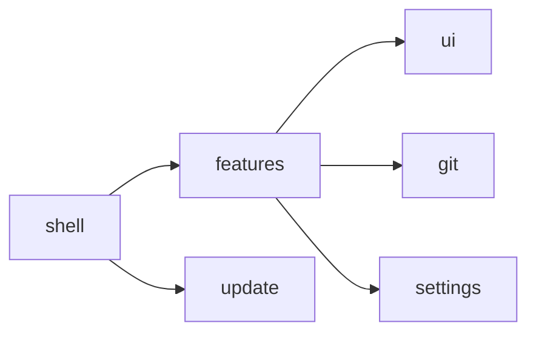
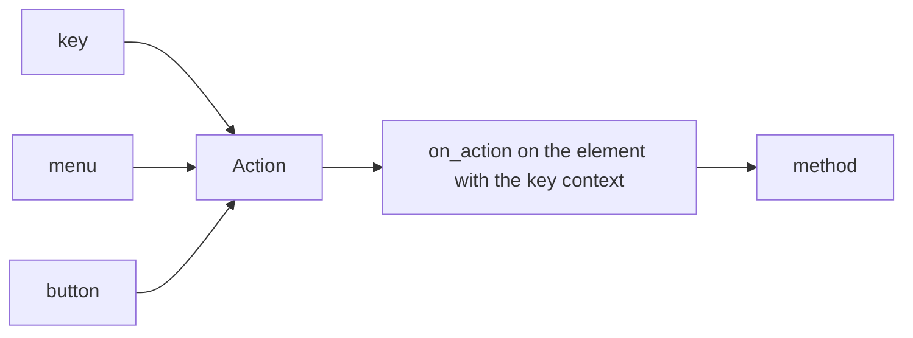

# Architecture

The rules here come from the GPUI Kit Coding Guides, vendored at
[`.claude/skills/build-gpui-apps/references/gpui-kit/upstream/docs/coding-guides.md`](../.claude/skills/build-gpui-apps/references/gpui-kit/upstream/docs/coding-guides.md).
Working with an AI agent? [AGENTS.md](../AGENTS.md) is the context it needs.

## Layers

Dependencies point one way:

- **ui**: reusable presentation (theme, title bar, tab strip, popovers, toasts,
  tooltips). It knows nothing about Git or about Rama.
- **git**: everything Git, by running the `git` CLI. No UI.
- **settings**: persisted preferences.
- **update**: the release manifest, the update check and the install. The
  shell wires it in (`src/updater.rs`).
- **features**: the product. Each module owns its state, its view and the
  actions it handles.
- **shell**: composes the window, handles application-wide actions and decides
  what is mounted where. It is the only place that knows the features.

## Where things live

| Path | What lives there |
| --- | --- |
| `src/main.rs` | Startup: settings, theme, menus, the window |
| `src/shell.rs` | Root view: title bar, overlay layers, the workspace |
| `src/features/workspace.rs` | One tab per open repository, the welcome screen behind them |
| `src/features/history/` | The repository screen: graph (`lanes.rs` model, `rail.rs` geometry, `node.rs` painting), rows, branch column, toolbar (`bar.rs`), detail panel (`detail/`) |
| `src/features/diff/` | Diff viewer, side by side and inline |
| `src/features/welcome/`, `settings_page.rs` | Home screen; preferences |
| `src/git/` | Git through the CLI (`command.rs`): history, status, refs, operations, conflicts, blame, forge links, repository watching |
| `src/settings/`, `src/recents.rs` | Preferences and recent repositories |
| `src/ui/` | Product-agnostic chrome |
| `src/update/`, `src/updater.rs` | Updates: manifest, check, install; the shell's wiring |
| `src/actions.rs`, `src/keymap.rs` | Application-wide actions and key bindings |
| `assets/icons/`, `src/assets.rs` | SVG icons beyond GPUI Kit's bundle |

## Who owns which state

| State | Owner | Why there |
| --- | --- | --- |
| A view's content | The feature's entity | It survives every frame without anyone storing it |
| Theme and base size | GPUI Kit's global `Theme` | It is already global; a copy would be a second truth |
| What is mounted | `Shell` | It is window state, not product state |

## One command, one implementation

A command is a GPUI action. Its shortcut, its menu item and any button dispatch
the **same value**; the handler lives in the view that owns the behaviour:

A button dispatches (`window.dispatch_action(Box::new(...), cx)`) instead of
calling the method, so there is only one path to diverge.

Bindings are scoped to a key context. `App` (`keymap::CONTEXT`) is declared on
the shell's root element and holds the application-wide ones; a view with
commands of its own declares its own context, so its shortcuts only exist
where it does. The keymap starts empty apart from `⌘Q` on macOS: a shortcut
ships together with something in the UI that shows it.

## Not re-rendering more than needed

GPUI keeps entities alive across frames and describes the element tree again
each frame. What keeps that cheap:

- nothing mutates state or calls `cx.notify()` inside `render`;
- a mounted view is an `Entity` stored by its parent, not rebuilt each pass;
- callbacks handed to `ui` are `Rc` closures, not views.

## Title bar

The band is built by hand (`src/ui/title_bar.rs`) instead of using GPUI Kit's
`TitleBar`, because `TitleBar` always draws its own minimize, maximize and
close buttons, on the right, in a fixed order, and they cannot be replaced.
The right behaviour depends on the platform:

- **Linux:** the desktop decides which corner and which order (GNOME's
  `button-layout`), and whether they are drawn depends on the decoration mode.
  `linux_buttons` reads the layout, drops what the compositor doesn't support
  and restores what the layout leaves out: under client-side decorations this
  band is the window's only chrome, so `appmenu:close` must not leave a window
  that can't be minimized.
- **Windows:** the system glyphs (Segoe Fluent) at their 36px metric, mapped to
  `WindowControlArea` so Windows handles them, Snap Layouts included.
- **macOS:** nothing is drawn; the traffic lights are native and
  `AppTitleBar::window_options` centres them in the band.

The drag region, double-click to zoom and the right-click window menu follow
the same contract as `TitleBar`.

It is a single 38px band (`TITLE_BAR_HEIGHT`) with no padding and no rule
underneath, so the top of the window reads as one surface. Its `content` slot
holds the repository tabs (`src/ui/tab_strip.rs`).

One non-obvious detail: the band starts a window drag on any `mouse_down` that
reaches it, so a press on a control would bubble up and the slightest movement
would hand the window to the compositor mid-click. `grab_proof` stops the press in
the control's wrapper, while empty space keeps dragging. Controls also carry
`occlude()`, which removes them from the strip's hit test; without it a double
click on a button would also zoom the window.
